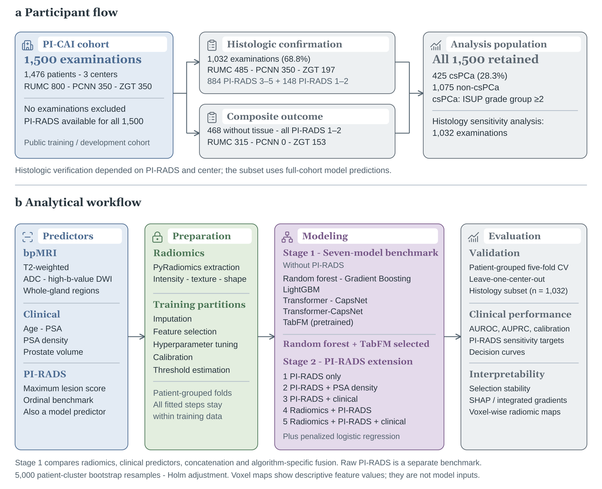

# Whole-gland MRI radiomics beyond PI-RADS for clinically significant prostate cancer

Code for the study *"Incremental value of whole-gland MRI radiomics beyond PI-RADS for clinically
significant prostate cancer: internal-external validation across three centers"* (manuscript under
review).

The study asks whether radiomic features computed from the **whole prostate gland** on biparametric
MRI add diagnostic information beyond the radiologist's **PI-RADS** score and routine clinical
variables (age, PSA, PSA density, prostate volume), and whether any gain holds in a hospital the
model has not seen. Clinically significant prostate cancer (csPCa) is ISUP grade group ≥ 2.



*Figure 1 of the manuscript. **a** Participant flow of the PI-CAI cohort. **b** Analytical workflow:
predictors, leakage-safe preparation within training partitions, the two modelling stages, and
evaluation.*

## Study at a glance

| | |
|---|---|
| **Data** | Public PI-CAI training/development set: 1,500 bpMRI examinations, 1,476 patients, 3 centers (RUMC 800, PCNN 350, ZGT 350); 425 csPCa (28.3%) |
| **Predictors** | Whole-gland PyRadiomics features from T2-weighted, ADC and high-b-value DWI; maximum lesion PI-RADS; age, PSA, PSA density, prostate volume |
| **Stage 1** | Seven-model benchmark on radiomics without PI-RADS: random forest, gradient boosting, LightGBM, Transformer, CapsNet, Transformer-CapsNet and a pretrained tabular foundation model (TabFM) |
| **Stage 2** | Random forest, TabFM and penalized logistic regression with five predictor sets: PI-RADS only, PI-RADS + PSA density, PI-RADS + clinical, radiomics + PI-RADS, and the complete model |
| **Validation** | Patient-grouped five-fold cross-validation; leave-one-center-out (LOCO) retraining; histology-confirmed subset (n = 1,032) |
| **Evaluation** | AUROC/AUPRC with 5,000 patient-cluster bootstrap resamples and Holm adjustment; calibration by center; operating points at PI-RADS-derived sensitivity targets; partial AUROC; decision curves |
| **Interpretability** | Selection stability, SHAP and integrated gradients, voxel-wise radiomic maps |

Every fitted step (imputation, feature selection, hyperparameter tuning, calibration, thresholds) is
learned inside the training partition of each fold.

## Main findings

- PI-RADS plus clinical variables reached an internal AUROC of 0.881 (TabFM). Adding whole-gland
  radiomics raised it to **0.897** (difference 0.016; 95% CI 0.007 to 0.025), with smaller increments
  for logistic regression (0.010) and random forest (0.012, not significant).
- Under LOCO the complete TabFM model reached 0.879, but **no algorithm showed a significant radiomic
  increment in any withheld center**.
- At the PI-RADS ≥ 4 sensitivity target, specificity was 0.686 versus 0.688 for PI-RADS, and net
  benefit did not significantly exceed PI-RADS ≥ 4 between 5% and 30% threshold probability.

Whole-gland radiomics modestly improved internal risk ranking, but the gain was not demonstrated in
new centers or at clinically relevant operating points; prospective evaluation is needed before use
in biopsy decisions.

## Data

The imaging data are **not redistributed** here. Download them from their sources:

- PI-CAI public training and development dataset: <https://doi.org/10.5281/zenodo.6624726>
- PI-CAI labels (including the official marksheet with PI-RADS): <https://github.com/DIAGNijmegen/picai_labels>

`artifacts/` holds the cohort manifest and the source feature tables used by the pipeline.

## Installation

Python 3.11 or later.

```bash
python -m venv .venv
source .venv/bin/activate
pip install -e ".[extraction,interpretability,dev]"
```

For the deep tabular models:

```bash
pip install -e ".[deep]"
```

TabFM runs on a GPU from a pinned checkpoint (`google/tabfm-1.0.0-pytorch`, Hugging Face revision
`3ba55df`) and source commit `05f2c8e`; `scripts/hpc/50_revision2_tabfm_gpu.sh` sets up that
environment.

## Reproducing the analyses

The analyses run as SLURM jobs in `scripts/hpc/`, numbered in execution order. Each entry point below
submits its jobs with `afterok` dependencies; pass `list` to print the order without submitting.

| Step | Entry point | Jobs |
|---|---|---|
| Stage 1: radiomics, clinical and deep benchmark, reports | `./run.sh` | 10–15 (optional 16–25) |
| Stage 2: PI-RADS extension, LOCO, sensitivity targets | `scripts/hpc/34_…` to `44_…` | 34–44 |
| LOCO retraining, PSA-density variants, isotonic calibration, TabFM; deep LOCO and nested model selection | `./run_revision_experiments.sh` (32 and 33 are submitted on their own) | 26–33 |
| PI-RADS + clinical comparator, logistic regression, corrected LOCO, feature-selection sensitivity, nested selection, voxel-map quantification, decision curves | `./run_revision2_experiments.sh` | 45–55 |

Outputs are written to `results/` and are ignored by Git. The figure generators are in
`scripts/analysis/` (for example `build_revision_figures.py` and `build_figure6_R1.py`).

### Command-line interface

```bash
prostate-radiomics build-features \
  --radiomics-root artifacts/radiomics \
  --mode gland \
  --keep-shape-from t2 \
  --output artifacts/radiomics/concatenated_data/features_all_gland.csv

prostate-radiomics train-classical \
  --config configs/experiments/picai1500_corr/classical_radiomics_only_ml.yaml

prostate-radiomics train-deep \
  --config configs/experiments/picai1500_corr/deep_radiomics_only.yaml

prostate-radiomics compare \
  --config configs/reports/picai1500_corr/clinical_comparison_thresholded.yaml
```

Add `--dry-run` to `extract`, `train-classical`, `train-deep` or `interpret` to print the resolved
command without launching it.

## Repository layout

```text
src/prostate_radiomics/   Importable package and the prostate-radiomics CLI
train/radiomics/          Model implementations used by the CLI
configs/                  Experiment and report configurations (PI-CAI 1500)
scripts/hpc/              SLURM jobs, numbered in execution order
scripts/analysis/         Statistical analyses, tables and figure generators
artifacts/                Cohort manifest and source feature tables
docs/                     Workflow, experiments, metrics, outputs and HPC notes
tests/                    Unit and smoke tests on synthetic data
archive/                  Earlier configs and scripts, outside the active workflow
results/                  Generated outputs (ignored by Git)
```

Further detail: [workflow](docs/workflow.md), [experiments](docs/experiments.md),
[clinical features](docs/clinical_features.md), [interpretability](docs/interpretability.md),
[metrics](docs/metrics.md), [outputs](docs/outputs.md) and [HPC](docs/hpc.md).

## Citation

If you use this code, please cite the repository ([`CITATION.cff`](CITATION.cff)). The citation of
the article will be added here once it is published.

## License

MIT; see [LICENSE](LICENSE).
